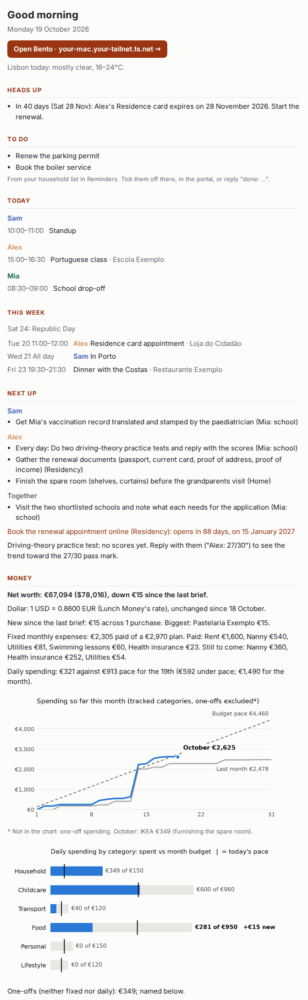
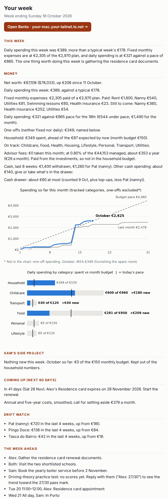
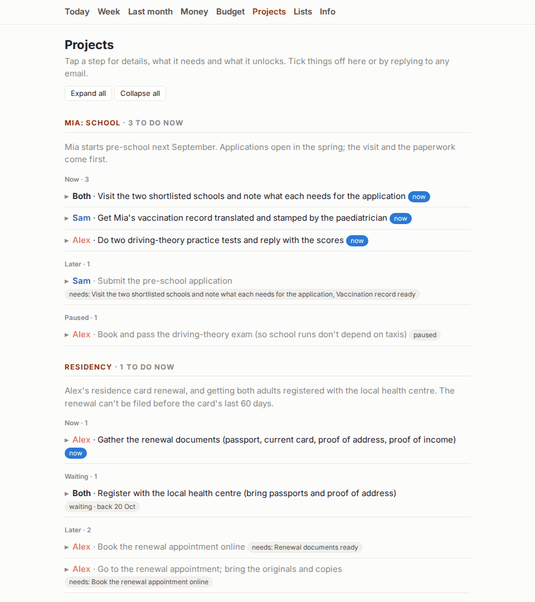
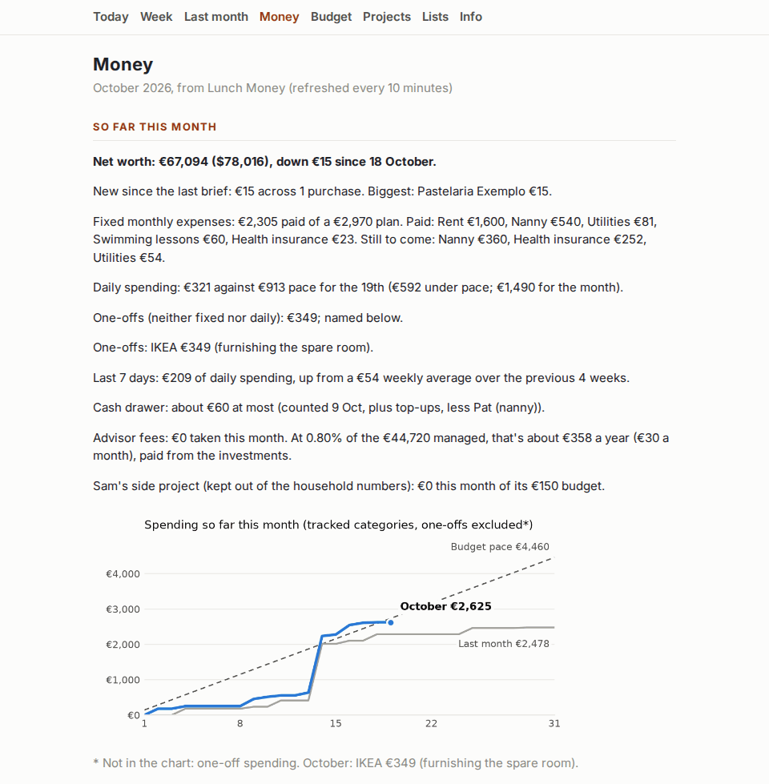
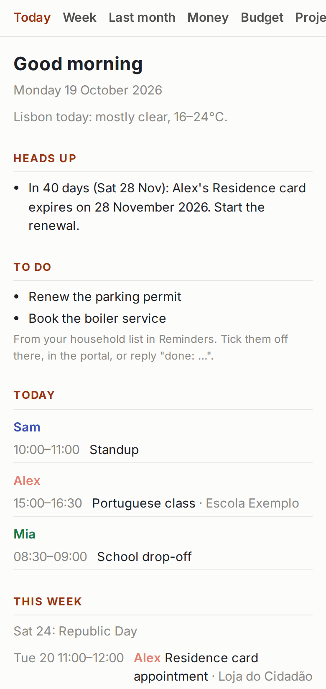

# Butler

Butler is your household's own AI butler. It runs on your Mac, works with your data, and
answers to the name you give it. Every morning it emails the adults in your home one brief: the day's calendar for each person, what to prepare for, your to-dos,
where the money stands, the next step on each family project, and the news you care about.
You reply in plain words to change things. A private web portal on your tailnet shows the
same information, with buttons.

It's built for families with real logistics: two calendars or more, a budget, paperwork with
deadlines, kids, maybe a move abroad. Claude does the reading and writing. Python does every
sum, and every change goes through a fixed list of actions.

**New to all this?** [Build Your Butler](https://buildyourbutler.com) is a free, step-by-step
course for people who've never used a terminal. You finish with a working butler, and you
learn how AI works along the way.

## What it looks like

Every picture below shows an invented household: Sam and Alex Johnson, their daughter Mia and
their nanny Pat, in Lisbon. Their butler is called Bento. A fresh copy of Butler runs on them
until you add your own details. The pictures are made by a script
([docs/TESTING.md](docs/TESTING.md#readme-screenshots)), so they always show the current version.

<table>
<tr>
<td width="50%" valign="top"></td>
<td width="50%" valign="top"></td>
</tr>
<tr>
<td><b>The morning brief.</b> Each person's day, the week ahead, the next step on each project, and where the money stands.</td>
<td><b>The Sunday letter.</b> The week in numbers, spending that's creeping up, and what to get done next week.</td>
</tr>
</table>

<table>
<tr>
<td width="40%" valign="top"></td>
<td width="40%" valign="top"></td>
<td width="20%" valign="top"></td>
</tr>
<tr>
<td><b>Projects in the portal.</b> What to do now, what's waiting, and what each step unlocks.</td>
<td><b>Money in the portal.</b> Fixed monthly expenses, daily spending and one-offs, kept apart.</td>
<td><b>On a phone.</b> The same portal, over Tailscale.</td>
</tr>
</table>

## What you get

| Email | When | What's in it |
|---|---|---|
| Morning brief | Daily, at the hour you choose | Weather, heads-up on deadlines and expiring documents, to-dos, today and this week per person, what to prepare for, next project steps, money, news |
| Weekly letter | Sunday, or the day you choose | The week in numbers with charts, bills due in the next 60 days, spending that's creeping up, the week ahead, ideas to save or earn, questions about unexplained transactions, where each project stands |
| Monthly look-back | The 1st | What got done, where the time went (from the calendar), where the money went, budget suggestions from your trend |

Reply to any of them: "add milk to shopping", "dentist for Mia Thursday at 10", "done: school
visit", "that Q-2026-41-1 charge was the plumber, Household", "apply the Transport suggestion",
"less sport in the news please".
A confirmation comes back to everyone within about five minutes.

The portal has the same views plus Money (every transaction, by category), Budget (the plan
as the service reads it), Projects (done, pause, send an update), Lists (Apple Reminders) and
Info (phones, IDs and document expiry dates, shown only there).

### Money, done carefully

Butler reads [Lunch Money](https://lunchmoney.app), which connects to your banks. It keeps
three kinds of spending apart, because mixing them is what makes budgets lie:

- **Fixed monthly expenses** (rent, insurance, a nanny's salary): paid against the plan.
- **Daily spending** (food, transport, household): paced through the month.
- **One-offs** (a sofa, a deposit): counted, named, and kept out of both.

On top of that, optional features cover what real households have: side ledgers kept out of
household spending (a side business, a shared repair with reimbursements), a cash drawer with
a recurring cash payment, advisor fees, rental income, a savings runway, net worth with
exchange-rate moves separated from real ones, and a budget in two currencies.

## Privacy

Butler was designed so a household can trust it with everything.

- **Your data stays on your Mac.** Config, projects, budget, notes and the email archive are
  local files. The `.gitignore` excludes all of them, so a fork can't publish them by accident.
- **Secrets live in the macOS Keychain**, never in files, logs or chat.
- **Nothing listens on the network.** The portal binds to 127.0.0.1. Tailscale makes it
  reachable from your own devices, and only from them.
- **ID numbers never leave the Info page.** Passport, residence and health numbers live in a
  git-ignored file that isn't read into emails or sent to Claude. Emails and prompts use
  document names and dates only.
- **Claude only proposes; Python acts.** Replies become actions from a fixed allowlist.
  Nothing can be deleted by a reply. Only trusted senders with a passing DKIM signature count.
- **News is quarantined.** The news call sees only your town and a sentence about what news
  you want, and it has no tools. Links always come from the feed, never from the model.

What does leave the Mac: calendar titles, project steps, money summaries and household notes
go to the Claude API to write the emails; email goes through the assistant's Gmail account;
Lunch Money and Open-Meteo are read over their APIs.

## Requirements

- A Mac that's on most mornings (macOS 14 or later). Butler wakes it for the brief.
- The Xcode command-line tools, for the Calendar helper. The installer provides Python.
- A [Lunch Money](https://lunchmoney.app) account (for the money sections).
- A [Claude API key](https://console.anthropic.com).
- A new Gmail account for the assistant, with an app password.
- Calendars in macOS Calendar (Google, iCloud or Exchange all work) and Apple Reminders.
- Optional: [Tailscale](https://tailscale.com) for the portal on your phones.

## Get started

Go to [buildyourbutler.com](https://buildyourbutler.com), name your butler, and download it.
The package installs into `~/Butler` without asking for your password. Then a Terminal window
opens, and your butler says hello. In about five minutes, you sign in by email and paste three
one-line lessons, and your first brief opens:

```
butler town "Lisbon"
butler adults Sam Alex
butler brief
```

Then `butler claude` moves into [Claude Code](https://claude.com/claude-code), where the rest of
the setup happens one step at a time. `butler status` says where you are, and `butler help`
lists the rest.

Prefer a terminal? The same install, without the package:

```
curl -fsSL https://raw.githubusercontent.com/nerolabs/butler/main/scripts/install.sh | bash
```

In Claude Code, the steps are:

| Step | What it does |
|---|---|
| `/butler-setup install` | Name your butler and see its first brief |
| `/butler-setup calendar` | Connect Calendar and Reminders |
| `/butler-setup brain` | Add a Claude API key, with a spending limit |
| `/butler-setup inbox` | Give it a Gmail address, send the first brief, start the schedule |
| `/butler-setup replies` | Reply by email or Siri to change things |
| `/butler-setup money` | Connect Lunch Money and draft your budget |
| `/butler-setup projects` | Family projects and paperwork |
| `/butler-setup letters` | The weekly letter and the monthly look-back |
| `/butler-setup phone` | The portal on your phones, with Tailscale |

`/butler-setup` on its own says where you are. You type secrets into a Mac dialog, so they
never pass through the chat. Later, `/butler-tune` adjusts the rules from your feedback, and
`/butler-doctor` checks everything when something seems off.

Prefer to do it by hand? Follow [docs/SETUP.md](docs/SETUP.md).

To look around first, Butler runs on an invented example household out of the box:

```
scripts/bootstrap.sh
./run.sh preview                      # builds this morning's brief and opens it; sends nothing
./run.sh portal                       # http://127.0.0.1:8787
```

## Staying up to date

Butler updates itself. Every night it checks for a new version, and it installs patches and
minor versions on its own. It installs only packages signed and notarized by Butler's
publisher, keeps the previous version, and goes back to it if anything doesn't check out. A
major version waits for you to reply "update". The next morning's brief says what happened.
`butler update` installs a new version straight away, and `updates: notify` or `off` in your
settings changes the behaviour. [docs/UPDATES.md](docs/UPDATES.md) has the details.

## Documentation

- [docs/SETUP.md](docs/SETUP.md): manual setup, step by step
- [docs/CONFIG.md](docs/CONFIG.md): every setting and money rule
- [docs/PROJECTS.md](docs/PROJECTS.md): family projects with steps, dependencies and dates
- [docs/PORTAL.md](docs/PORTAL.md): the portal over Tailscale, and under your own domain
- [docs/UPDATES.md](docs/UPDATES.md): over-the-air updates, rollback and the kill switch
- [docs/TESTING.md](docs/TESTING.md): how Butler is tested, all automated
- [SECURITY.md](SECURITY.md): how to report a vulnerability

## Support

Butler is free and MIT-licensed. If it saves your household some hours, you can buy us a coffee.
<!-- TODO: Buy Me a Coffee link -->
(Link coming soon.)

Issues and pull requests are welcome. Please never include real household data in them: use
invented names, as the examples do.
